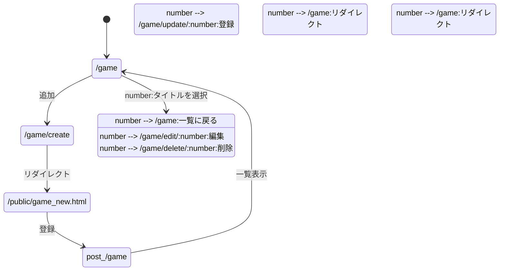
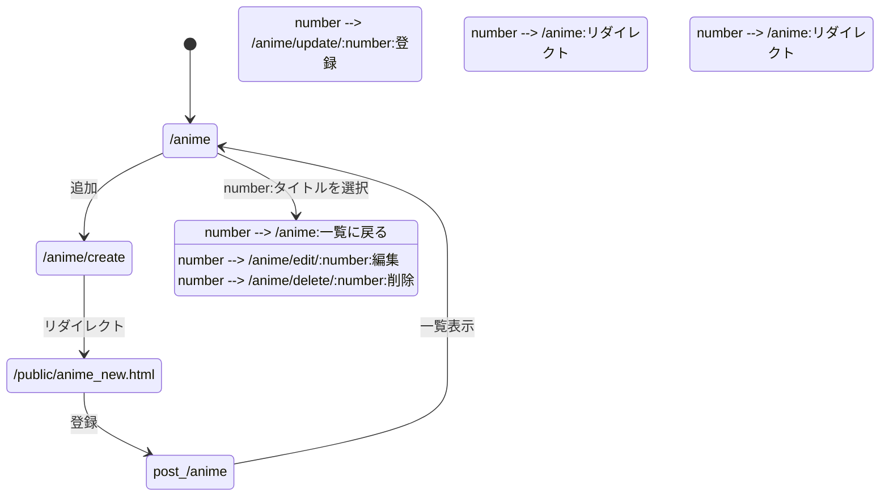

# レポート用システムの設計

京葉線システム以外に，以下の3つのWebアプリケーションを開発する．
いずれも一覧表示をベースとし，データの一覧・詳細表示，追加，削除，変更を行う．
データは変数内に記録する．

各システムのリソース名とページ遷移は，京葉線データベースアプリ（keiyo2）と統一する．
削除は詳細ページから実行する．

---

## 1. 好きなゲーム紹介システム

### 対象
自分の好きなゲームを記録・紹介する．
どんなゲームか，どこが好きかを一覧と詳細ページで見られるようにし，人に勧めるときにも使えるようにする．

### ページ遷移図

### スキーマ

項目名 | 型 | 内容 | 例
-|-|-|-
id | 数値 | ID | 1
title | 文字列 | タイトル | スプラトゥーン3
hard | 文字列 | 機種 | Nintendo Switch
genre | 文字列 | ジャンル | アクション
release | 文字列 | 発売日 | 2022-09-09
rating | 数値 | おすすめ度（1〜5） | 5
point | 文字列 | 好きなポイント | 友達と協力して遊べる

---

## 2. アニメ視聴記録システム

### 対象
見たアニメ・見ているアニメを記録する．
何話まで見たかと自分の評価を残し，続きを見るときや人に勧めるときに使えるようにする．

### ページ遷移図

### スキーマ

項目名 | 型 | 内容 | 例
-|-|-|-
id | 数値 | ID | 1
title | 文字列 | タイトル | 葬送のフリーレン
season | 文字列 | 放送時期 | 2023年秋
studio | 文字列 | 制作会社 | マッドハウス
episodes | 数値 | 全話数 | 28
watched | 数値 | 見た話数 | 28
rating | 数値 | 自分の評価（1〜5） | 5

---

## 3. キャラクター図鑑システム

### 対象
ゲームやアニメに登場する好きなキャラクターを記録する．
登場作品や声優，好きなポイントを図鑑のようにまとめて見られるようにする．

### ページ遷移図

### スキーマ

項目名 | 型 | 内容 | 例
-|-|-|-
id | 数値 | ID | 1
name | 文字列 | 名前 | フリーレン
work | 文字列 | 登場作品 | 葬送のフリーレン
voice | 文字列 | 声優 | 種﨑敦美
birthday | 文字列 | 誕生日 | 不明
point | 文字列 | 好きなポイント | 魔法への探究心
