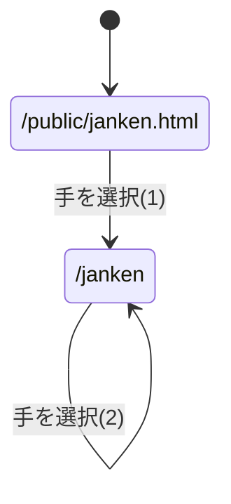
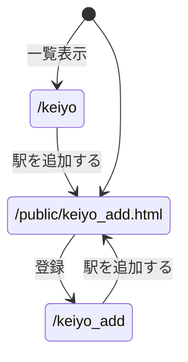
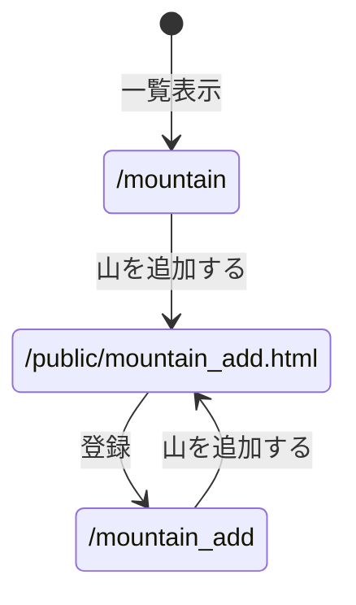

# webpro_06のページ遷移図

### じゃんけん関係
#### ページ遷移図

#### (1)のパラメータ

パラメータ名 | 属性 | 内容 | 値
-|-|-|-
hand | text | ユーザの手 | グー/チョキ/パー
win | hidden | 勝利数 | 0
total | hidden | 対戦数 | 0

#### (2)のパラメータ

パラメータ名 | 属性 | 内容 | 値
-|-|-|-
hand | text | ユーザの手 | グー/チョキ/パー
win | hidden | 勝利数 | これまでの勝利数
total | hidden | 対戦数 | これまでの対戦数

### 京葉線の駅関係
#### ページ遷移図

/keiyo_add はデータを追加したあと，db2.ejs による一覧表示を返す．
（データ登録画面にリダイレクトする方法も試したが，追加したデータが反映されたかすぐに確認できる一覧表示の方が良いと判断した）

#### /keiyo_add のパラメータ

パラメータ名 | 属性 | 内容 | 値
-|-|-|-
id | number | ID | 数値
code | text | 駅コード | JE01 など
name | text | 駅名 | 文字列

### 日本の山関係
#### ページ遷移図

#### /mountain_add のパラメータ

パラメータ名 | 属性 | 内容 | 値
-|-|-|-
id | number | ID | 数値
name | text | 山名 | 文字列
height | number | 標高(m) | 数値
pref | text | 都道府県 | 文字列
